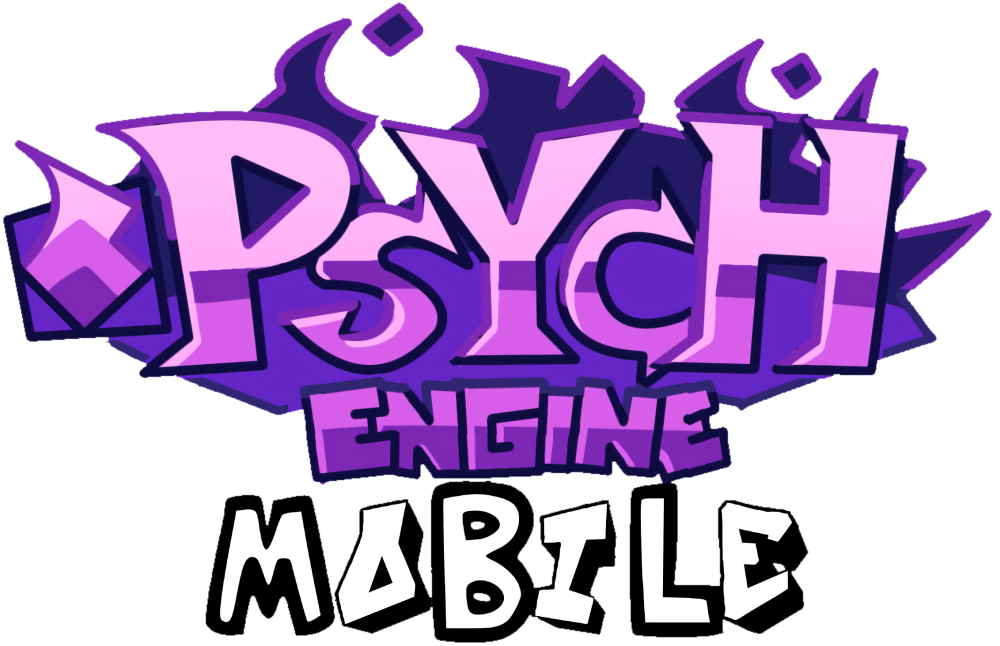

# PsychEngine-Custom



A custom mobile fork of Psych Engine (v1.0.4) for Friday Night Funkin'. It is built as an Android APK and is aimed at making mods without editing the engine source.

This fork differs from the upstream Psych Engine in these ways:

* The base game content (FNF 0.6 classic weeks, songs, characters and videos, about 470 MB) has been removed. Weeks now come only from mods. Story Mode, Freeplay and the Master Editor show "NO MOD INSTALLED" and exit if no mod is enabled.
* Custom States can be written in Lua or HScript and opened from anywhere, not only as substates of PlayState.
* Global scripts run for the whole session.
* Custom loading overlay with a script hook and an optional JSON config.
* A real loading gate: `PlayState` only starts after the song's required assets are in the cache.
* Video playback is managed through a `VideoManager` API for Lua and HScript.
* Several race-condition and null-safety fixes in the loading system and script layer.

## Installation (Android)

Mods live in external storage:

```
/sdcard/.PsychEngine/mods/<ModName>/
/sdcard/.PsychEngine/modsList.txt
```

Enable a mod by adding a line to `modsList.txt`:

```
MyMod|1
```

## Build

The only supported build path is GitHub Actions. Building locally is not supported on the target host.

1. Push to `main`. `.github/workflows/android-build.yml` runs automatically.
2. A build takes about 20 minutes. Download the `androidBuild` artifact.
3. Install the APK and enable your mod.

## Custom States

A Custom State is a full `FlxState` driven by scripts. Its files go in:

```
mods/<Mod>/customStates/<stateName>/state.lua   (or state.hx)
mods/<Mod>/customStates/<stateName>/helper.lua  (loaded automatically)
```

On Android, scripts must be inside a mod folder. `assets/shared/` inside the APK is not scanned.

Open a state from Lua or HScript:

```lua
switchCustomState('freeplay')
```

```hx
CustomState.openState('freeplay');
```

Return to the main menu with `exitCustomState()`. Lifecycle callbacks are `onCreate(stateName)`, `onCreatePost`, `onUpdate(elapsed)`, `onUpdatePost`, `onBeatHit`, `onStepHit` and `onDestroy`.

Freeplay API for Custom States: `getFreeplaySongList()`, `selectFreeplaySong(week, folder)`, `getFreeplayScore(song, diff)` and `playFreeplaySong(song, diff)`.

Menu navigation helpers: `goToStoryMode()`, `goToFreeplay()`, `goToCredits()`, `goToOptions()`, `goToModsMenu()`, `goToAchievements()`, `initMenuMods()` and `quitGame()`.

Full reference: `CUSTOM-STATE-COMPLETE.md` and `Custom-State-Implementation-Guide.md`.

## Global Scripts

Scripts in `customStates/global/` are loaded once and run across states. They receive `onCreate()`, `onUpdate(elapsed)` and `onStateSwitch(stateName)`.

## Loading Overlay

Create `mods/<ModName>/CustomStates/loading-overlay/OverlayLoading.hx` to replace the loading screen. The script can use `onPreload`, `onCreate`, `onLoadingCompleted`, `waitForContinue`, `onContinue`, `onUpdate` and `onDestroy`.

A simpler option is `mods/<ModName>/data/loadingScreen.json`, which sets `background`, `barColor`, `barBackgroundColor`, `text` and `logo`. A `LoadingScreen.hx` script takes priority over the JSON config.

Details: `docs/LoadingOverlayModding.md`.

## Loading System Changes

* `loaded` and `threadsCompleted` are updated under a `Mutex`. Before this change, the counters could lose increments across threads and loading could hang.
* `checkLoaded()` also verifies that every required image and sound for the current song is actually in `Paths.currentTrackedAssets` or `Paths.currentTrackedSounds`. A count match alone is no longer enough.
* Missing sounds fall back to a cached beep, and missing images fall back to a 1x1 placeholder. A missing file therefore does not block the gate.

## Video API

Videos are loaded from the mod's `videos/` folder.

```lua
playVideo('intro', 'custom', -1, false, false, 0, 0)
setVideoProperty('intro', 'alpha', 0.9)
skipVideoAndSeek('intro', getVideoLength('intro'))
```

Full reference: `docs/VideoManager.md`.

## Editors

The Master Editor Menu includes the Chart Editor, Stage/Character Editors and an extension system. See `docs/EditorExtensions.md`.

## Maintainer

* Ton (tonn5698-glitch) - Creator and lead of PsychEngine-Custom. Handles the fork's direction, ideas, debugging and testing.

## Mobile Credits:
* Homura - Head Porter of Psych Engine Mobile.
* Karim - Second Porter of Psych Engine Mobile.
* Moxie - Helper of Psych Engine Mobile.

## Credits:
* Shadow Mario - Main Programmer and Head of Psych Engine.
* Riveren - Main Artist/Animator of Psych Engine.
* kittycathy233 - Base Psych Engine Mobile fork and forked libraries (lime, hxcpp, flixel, linc_luajit).

### Psych Special Thanks
* bbpanzu - Ex-Team Member (Programmer).
* crowplexus - HScript Iris, Input System v3, and Other PRs.
* Kamizeta - Creator of Pessy, Psych Engine's mascot.
* MaxNeton - Loading Screen Easter Egg Artist/Animator.
* Keoiki - Note Splash Animations and Latin Alphabet.
* SqirraRNG - Crash Handler and Base code for Chart Editor's Waveform.
* EliteMasterEric - Runtime Shaders support and Other PRs.
* MAJigsaw77 - .MP4 Video Loader Library (hxvlc).
* iFlicky - Composer of Psync, Tea Time and some sound effects.
* KadeDev - Fixed some issues on Chart Editor and Other PRs.
* superpowers04 - LUA JIT Fork.
* CheemsAndFriends - Creator of FlxAnimate.
* Ezhalt - Pessy's Easter Egg Jingle.
* MaliciousBunny - Video for the Final Update.

#### Psych Engine by ShadowMario, Friday Night Funkin' by ninjamuffin99
